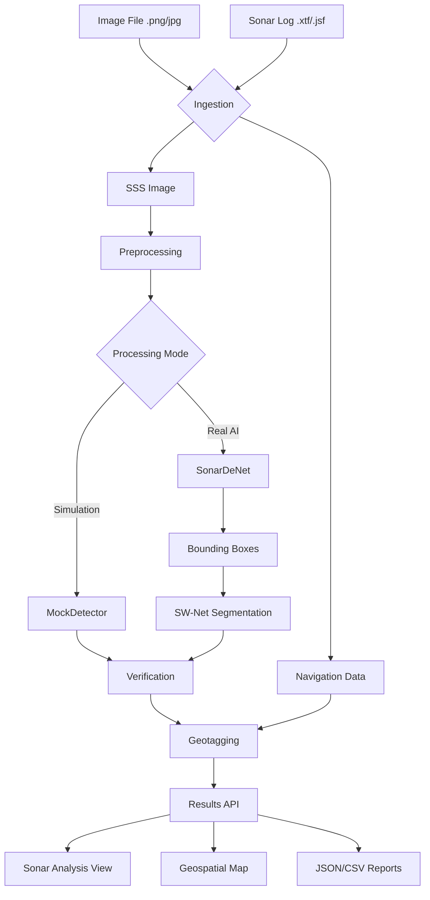

# AquaScan AI — Sonar Anomaly Detection

AquaScan AI is a prototype web application designed for analyzing Side-Scan Sonar (SSS) imagery and extracting targets like Ghost Nets, Pipes, Cylinders, and Shipwrecks using deep learning (SonarDeNet + SW-Net).

## Architecture

This project has been transformed into a fully connected pipeline supporting both **Simulation Mode** (mock data) and **Real AI Mode** (running actual deep learning models on sonars).



## Setup & Installation

### Backend

1. Install Python 3.9+
2. Install dependencies:
   ```bash
   cd backend
   pip install -r requirements.txt
   ```
3. Configure the environment variables:
   Copy `.env.example` to `.env` and set your preferred `PROCESSING_MODE`.
   ```bash
   cp .env.example .env
   ```
4. Start the FastAPI server:
   ```bash
   uvicorn main:app --reload
   ```

### Frontend

1. Install Node.js 18+
2. Install dependencies:
   ```bash
   cd frontend
   npm install
   ```
3. Run the development server:
   ```bash
   npm run dev
   ```
4. Or build for production:
   ```bash
   npm run build
   ```

## Operating Modes

### Simulation Mode
- Uses `MockDetector` to generate deterministic mock detections.
- Produces simulated geographic coordinates near Chennai.
- Fully functional out of the box without requiring real model weights or navigation metadata.

### Real AI Mode
- Requires actual SonarDeNet and SW-Net PyTorch weights configured in the `.env` file (`SONARDENET_MODEL_PATH`, `SWNET_MODEL_PATH`).
- Extracts images from XTF sonar logs and runs inference.
- Geotags detections using true sonar geometry and navigation data when provided.
- If no navigation metadata is present (e.g. standard PNG upload), returns "Location unavailable".
- If weights are missing, the system safely raises a configuration error rather than fabricating predictions.

## Geotagging Limitations
- Standard images without geospatial metadata will not be plotted on the Map.
- XTF files will only generate real geotagging if valid navigation records are extracted.

## Testing & Troubleshooting
- Ensure `pyxtf` and other required system dependencies for CV/ML are correctly installed if running Real AI mode.
- Check the Backend `/api/system-status` or the Frontend System Status page to verify if your models are correctly loaded.
